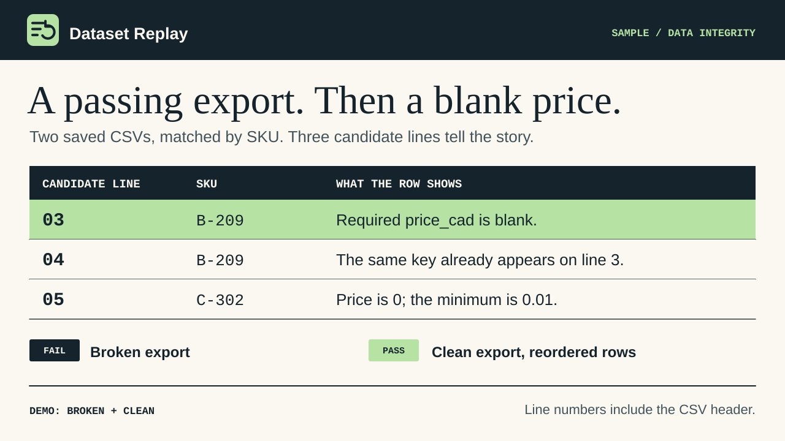

# Dataset Replay

**Find the source lines behind failed CSV checks.** Your scraper finished. The new price export has five rows instead of four. Did you gain a product, or did the scraper duplicate one and lose a price? Compare the export with a saved baseline using a key such as SKU. No row-by-row eyeballing, and no false alarm just because rows moved.

## Try the synthetic demos

From the unpacked directory, use an existing Node 22.18+ (22.x) or Node 24.2+ runtime. No npm install or account.

```sh
node server.mjs --demo broken
node server.mjs --demo clean
node server.mjs --receipt < examples/short-export.json
```

| Synthetic comparison | Expected result |
| --- | --- |
| Broken retail run | Candidate failed: line 3 has a blank price; line 4 repeats the SKU first seen on line 3; line 5 contains the literal price `0`. The baseline passed. |
| Same four products, reordered | Both exports pass. No keyed rows changed. |
| Short export | All individual prices are valid, but only **1 of 4** products remains. The minimum row count and key coverage fail at dataset level, not at a made-up line number. |



*Illustration from the bundled synthetic fixture. [Cover artwork](assets/cover.png) and [alt text](assets/ALT-TEXT.md).*

**In Cursor after local registration:** ask “Run Dataset Replay’s broken demo. Show the failing lines. Then run the clean demo.” The server returns a text receipt and, for compatible hosts, a report view. Open [the standalone preview](preview.html) for a precomputed **synthetic preview**, not a live Cursor session. The local plugin was tested in Cursor 3.30.14 on Windows with the broken and clean synthetic cases.

## Check your own exports

Use a JSON object containing `baselineCsv`, `candidateCsv` and `policy`. The first two fields are CSV **text**, not file paths, URLs or spreadsheet IDs. The program does not open them as locations. See [a runnable two-row example](examples/request.json).

```json
{
  "key": "sku",
  "minCandidateRows": 4,
  "minKeyRetention": 1,
  "requiredValues": ["price_cad"],
  "numericRules": [{"column": "price_cad", "min": 0.01, "maxPercentChange": 25}]
}
```

Choose thresholds that reflect *this* feed: the example means at least four new rows, every eligible baseline SKU still present, each price at least one cent, and at most a 25% price change for unambiguously matched products. If the feed legitimately drops seasonal SKUs, 100% coverage may be too strict.

- `key` is required. Names and IDs are exact, case-sensitive strings. A whitespace-only key is missing; a nonblank key is **not trimmed**. Duplicate or blank keys are not matched. The duplicate evidence names its first occurrence.
- `requiredColumns` checks header presence; `requiredValues` also checks that each cell is nonblank. They apply on both sides. A literal zero is not blank.
- `minCandidateRows` (0–10,000) checks the total candidate data records. `minKeyRetention` (0–1) checks what fraction of the **distinct, unambiguous baseline keys** occurs at least once in the candidate. A duplicate candidate key is present but still fails uniqueness and cannot claim a matched change. No eligible baseline keys with a retention policy means the reference failed. **Without these opt-in checks, a header-only export can pass with all rows reported removed.**
- Numeric rules accept inclusive `min`, `max`, absolute `maxChange` and relative `maxPercentChange` (25 means 25%, not 0.25%). Change limits apply only to unambiguously matched rows. Percent change uses the magnitude of the baseline. Zero to zero is unchanged; zero to nonzero is flagged as undefined, not assigned an invented percentage. Missing values needed for a percent comparison are flagged on the relevant side. Other numeric rules ignore blanks unless required. Nonblank, nonnumeric cells fail.
- Decimal CSV values are compared without binary floating-point subtraction. Up to 128 significant digits and a nonzero scientific exponent from −324 through +308 are supported; values beyond these bounds are reported as invalid numbers. Policy thresholds arrive as JSON numbers: use ordinary quantities representable by the host, not arbitrarily precise JSON numeric literals. Text formatting can still count as a row change (`1.00` vs `1`).

## Read the receipt

`report.status` is the overall policy pass/fail. `report.verdict` distinguishes `pass`, `reference-failed`, `candidate-failed`, and `both-failed`. A bad baseline is not evidence the candidate regressed. A malformed CSV is an **input error**, never a pass or a repaired comparison. Both completed PASS and FAIL comparisons exit the CLI successfully; callers should read `report.status` for a CI decision. Input errors exit nonzero or return an MCP tool error.

Evidence identifies baseline or candidate, starting physical line (including a multiline quoted record's start), and 1-based data-record ordinal. Headers have no record ordinal. Whole-export checks have no source line or record. Row/column additions and removals are informational unless a policy check fails. There is no positional fallback.

Four SHA-256 values fingerprint the exact UTF-8 CSV strings, the policy, and the report. For the latter two, object keys sort recursively; arrays keep their order. Line endings and a leading BOM affect an input fingerprint even when the verdict is unchanged. A fingerprint is not a signature, anonymization or proof about an upstream source.

## Limits and privacy

Each CSV: 250,000 UTF-16 code units, 10,000 data rows, 128 columns and 8,192 code units per parsed field. Input envelope: 4 MiB. The engine returns up to 200 findings and 200 changes, with up to 24 differing fields each. Omission counts and source coordinates are retained; long values and keys are excerpts. Chat text and the UI show smaller samples. Input is comma-delimited CSV: UTF-8, doubled quotes, and standard line endings. A malformed width, quoting error or duplicate header stops the run. JSON is used for the request and receipt, **not** as an alternate dataset format.

The local Node process reads stdin and writes results to stdout. It does not access a database, upload anything, fetch URLs, read dataset files, or save/export results for you. Do not infer that data passed through Cursor stays offline: host, transcript or model-provider policies may apply. For sensitive authorized data, use the CLI locally. Treat evidence as untrusted data, never as instructions.

On Windows PowerShell, pipe bundled examples with `Get-Content -Raw -Encoding UTF8 examples/short-export.json | node server.mjs --receipt` (bundled inputs are ASCII). For non-ASCII data, ensure the pipe preserves UTF-8. See [test and compatibility notes](TESTING.md).

## License

[MIT](LICENSE). Dataset Replay is an independent plugin, not an official Cursor product. Cursor account or model limits are separate from this plugin. The local CLI runs without a Cursor account.
